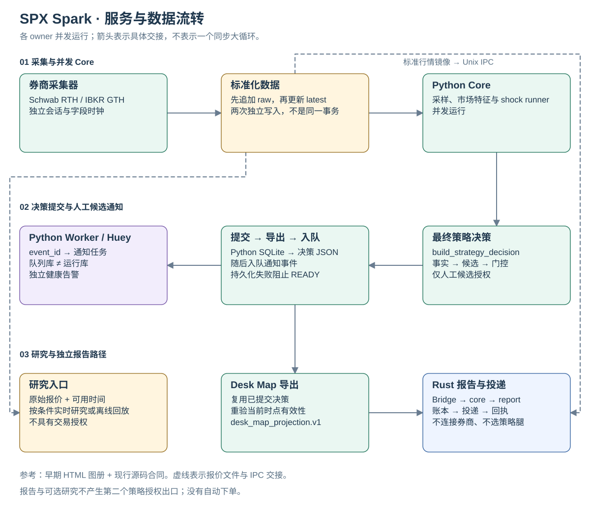

# SPX Spark

[English](README.md) · [简体中文](README.zh-CN.md)

**面向人工决策的 SPX/SPXW 行情、策略研究与 Desk Map 系统。**

SPX Spark 采集券商行情、评估策略候选、发布市场摘要，并利用归档报价进行研究回放。
Schwab 负责常规交易时段（RTH），IBKR Paper 负责全球交易时段（GTH）及备用行情。
所有候选均由人工决策：`automatic_ordering=false`，不具备真实或 Paper 自动下单能力。

[架构与设计图](docs/architecture/README.zh-CN.md) ·
[交互 HTML 说明](docs/architecture/service-flow.html) ·
[部署手册](docs/headless-deployment.md#cloud-delivery-cutover-2026-10-17) ·
[数据能力](docs/market-data-capability-matrix.md) ·
[文档目录](docs/README.md#document-catalog) · [协作约束](AGENTS.md)

## 系统能力

- **采集并核验数据。** 保留券商报价、来源身份，以及价格、Greeks 和持仓量各自的可用时间。
- **评估人工候选。** 按当前 SPX 合同评估方向 Debit Spread、铁鹰与蝶式；更广泛的扫描器和研究视图不自动取得生产策略权限。
- **发布 Desk Map。** 区分市场背景、候选授权、定时报告和投递回执。
- **从原始报价开展研究。** 按因果时间回放券商观测，保留缺失数据和失败结果。
- **分离生产与开发。** GitHub Actions 云端构建，Oracle 运行线上服务，家庭节点承担定时历史研究。

## 当前运行架构

架构基准：**2026-10-17**。下图说明已部署的交付和研究路径，不是实时健康监控。



| 位置 | 职责 |
| --- | --- |
| 云端开发 Agent / 开发者 | 修改代码、提交 PR |
| GitHub Actions、Releases、GHCR | 测试、构建 AMD64/ARM64 产物、发布不可变版本并部署已合并代码 |
| Oracle VPS | 在线采集、策略评估、报告、通知和运行状态；既有 systemd 服务运行预构建 ARM64 原生包 |
| 树莓派 | Prefect 调度、任务元数据、轻量日归档传输 |
| Linux 研究笔记本 | 使用固定 AMD64 容器和专用 `/srv/research` 研究盘进行回放与回测 |
| NAS | 已核验的报价快照、清单、研究结果和备份回执 |
| Mac | 审阅、运维和按需研究；未注册为定时计算 Worker |

### 服务与数据流转

采集器、Python Core、Python Worker 与 Rust 报告路径各有负责方。Core 内部的采样、
市场特征和 shock 任务并发运行；下图说明它们之间的交接，不是一个同步大循环。



[打开完整尺寸图](docs/architecture/diagrams/runtime.zh-CN.svg) ·
[下载交互说明 — English / 中文](https://raw.githubusercontent.com/hzy-hits/SpxOpDaily/master/docs/architecture/service-flow.html) ·
[原始 HTML 图册 — 中文历史快照](docs/architecture/reference/README.md)

交互说明包含独立视图、缩放、流程检索和源码入口。GitHub 只显示 HTML 源码，下载文件后用
浏览器打开即可。原始图册保留其 `97fc378` 源码基准；现行云端交付与家庭研究另在新说明中记录。

Python 负责券商采集、分析、研究和最终策略决策，`build_strategy_decision` 是唯一
人工候选授权出口。Rust 保留 typed readiness、frames、定时 Desk Map 和报告投递路径；
不连接券商、不为 Python 策略选腿，完整 `strategy_decision` 不进入 Rust wire。

具体边界见[运行时架构图](docs/architecture/README.zh-CN.md#runtime-and-data-ownership)、
[单仓库合同](docs/monorepo-layout.md)与[通知合同](docs/notification-architecture.md)。
沿用现有 Python/Rust 分工，架构不预设语言迁移。

## 交付与运行

PR 执行 Python、Rust 检查及原生 AMD64/ARM64 包验证。变更合并至 **`master`** 后，
符合路径条件的 CI 发布 `runtime-<完整提交 SHA>` GitHub Release 和 GHCR 镜像。
受限部署接收器校验 ARM64 包并更新 Oracle 的既有服务，运行验收失败时回退到先前程序版本。

Oracle 正常部署时不拉源码、不解析依赖、不编译，使用**原生运行包**；家庭研究笔记本
使用**同一提交的容器镜像**。凭据、数据库和券商 Gateway 保持既有主机归属。
数据库迁移变更会阻止自动部署；程序回滚不等于数据库回滚。

仅修改文档的主线提交不匹配部署工作流的 push 路径，因此更新文档不会重启生产。

[交付架构图](docs/architecture/README.zh-CN.md#build-release-and-deployment) ·
[部署操作说明](docs/headless-deployment.md#cloud-delivery-cutover-2026-10-17) ·
[运行时刻表](docs/operations-schedule.md) ·
[Rust 运维](rust/docs/OPERATIONS.md)

## 历史数据与周末研究

- **工作日 17:30 America/New_York：** 树莓派通过已有私网连接从 Oracle 拉取已关闭、已核验的报价分区，流式写入 NAS；NAS 重读核验后才发布快照。
- **周六 10:00 Asia/Shanghai：** 笔记本固定归档数据集、有效生产策略配置快照及同版本镜像，回放当前 SPX 生产策略，分别汇总 RTH/GTH 结果。
- **每次任务之后：** 报告、日志、输入清单、代码/配置身份和校验值备份到 NAS；待完成的结果备份可以补传。

家庭调度部署由本应用仓库以外的基础设施管理。克隆本仓库不会自动部署 Prefect、NAS 或 Worker。
[研究架构说明](docs/architecture/README.zh-CN.md#archive-and-research-lifecycle)记录接入方式及现有限制。

## 本地开发

开发设备需安装 **Python 3.12+**、**uv**；修改 Rust 时使用 [CI](.github/workflows/ci.yml)
固定的工具链。券商连接需要另行配置；以下命令不会启动生产服务。

```bash
git clone https://github.com/hzy-hits/SpxOpDaily.git
cd SpxOpDaily
uv sync --frozen
uv run spx --help

# 局部检查；按实际改动补充相关测试。
uv run pytest -q tests/test_iron_condor.py tests/test_desk_map_projection_export.py
uv run lint-imports
uv run ruff check src tests scripts
git diff --check
```

修改行为前先读 [AGENTS.md](AGENTS.md)，移动代码前先读[模块架构](module-architecture.md)。
完整发布验收与 Rust 命令见[单仓库指南](docs/monorepo-layout.md#ci-and-local-validation)。

## 仓库结构

| 路径 | 内容 |
| --- | --- |
| `src/spx_spark/` | Python 采集、策略、研究、Core/Worker 和运维 |
| `rust/` | 现有 typed core、bridge、ledger、report 和 delivery |
| `contracts/golden/` | 共享 wire 示例与验收 fixtures |
| `tests/`、`rust/crates/*/tests/` | Python/Rust 行为、因果、经济及外部边界检查 |
| `.github/workflows/ci.yml`、`Dockerfile`、`scripts/deploy-release.py` | 云端构建与受控生产交付 |
| `config/`、`systemd/` | 跟踪的默认值、部署示例和服务定义 |
| `docs/architecture/` | 中英说明、疏排 SVG 图、交互 HTML 和原始源码图册 |
| `docs/`、`site/` | 合同、运维、历史证据、通知图片入口和历史复盘页 |

## 解读与限制

全局策略基线为 `strategy_policy.bootstrap.v69`，后续局部变更见
[策略合同索引](docs/README.md#strategy-contracts)。生产以 0DTE 为主；多到期查询或研究
不代表持续完整报价覆盖，也不等于授权 3–5 DTE 生产策略。

进程健康或行情流推进，不代表 Greeks、持仓量、exact option legs、策略权限或通知投递
已经就绪；这些状态各有独立证据和时钟。历史路径模拟频率不是校准后的胜率，也不是策略盈利证明。

周末回放评估的是**当前代码及捕获的策略配置在历史报价上的表现**，并非完整还原历史线上决策
或成交：初始特征、历史模型/宏观/provider 状态、市场冲击和组合约束仍不完整。
历史策略卡、`NO_TRADE` 记录和通知历史不能用于筛选回测样本或证明 edge。

旧版实时行情 / Replay 网站已退役。[通知图片入口](site/spxw-surface/README.md)和
[历史策略复盘页](site/strategy-review/README.md)不是实时持仓或完整行情界面。
带日期的事故报告保留原始观测；证据及文档优先级见[完整目录](docs/README.md)。
