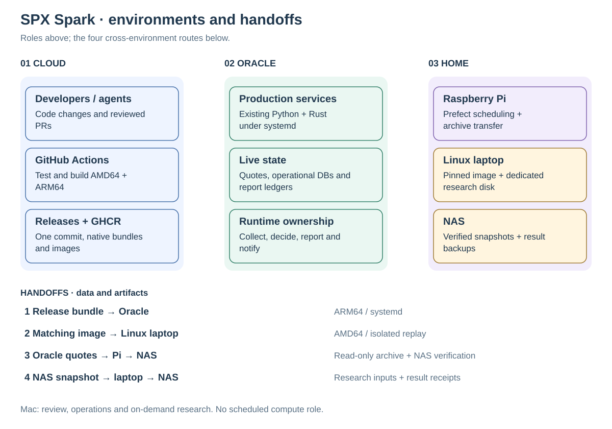

# Architecture guide

<!-- documentation-status: 2026-10-18 -->

[English](README.md) · [简体中文](README.zh-CN.md) · [Project home](../../README.md)

**Develop and build in the cloud. Run production on Oracle. Schedule at home,
compute on the research laptop, and retain verified data on NAS.**

This guide describes the deployed baseline checked on **2026-10-17**. It separates
application ownership from physical placement and distinguishes completed
integration checks from research claims. The home infrastructure is managed in a
separate operations workspace; this repository contains the application, release
pipeline, and integration documentation, not a complete home-lab installer.

## Interactive guide and original HTML

[Download the bilingual interactive guide](https://raw.githubusercontent.com/hzy-hits/SpxOpDaily/master/docs/architecture/service-flow.html)
([HTML source](service-flow.html)) for one view at a time, zoom, searchable service
handoffs, and source references. It defaults to English and includes Chinese.
GitHub displays HTML as source: download and open it in a browser for interaction.

The [original Chinese atlas](reference/README.md) is also preserved, including its
24 call flows, 72 key data-dictionary entries, module/type indexes, and interactive
inspectors. It is a historical source map pinned to `97fc378`, not a current
production audit. The new service-flow diagram uses its owner/commit/export
boundaries, checked against the current source; the cloud/home diagrams describe
the subsequently deployed integration.

## Diagram index

| View | English | Chinese |
| --- | --- | --- |
| System overview | [SVG](diagrams/system-overview.en.svg) | [SVG](diagrams/system-overview.zh-CN.svg) |
| Runtime and data ownership | [SVG](diagrams/runtime.en.svg) | [SVG](diagrams/runtime.zh-CN.svg) |
| Build, release, and deployment | [SVG](diagrams/delivery.en.svg) | [SVG](diagrams/delivery.zh-CN.svg) |
| Archive and research lifecycle | [SVG](diagrams/research.en.svg) | [SVG](diagrams/research.zh-CN.svg) |

SVGs render directly in GitHub and can be opened at full size. The environment
view separates role cards from four numbered handoff routes. Other views use
separate stages and fixed spacing; the dashed routes in the runtime
view denote quote files and IPC. Arrows describe specific calls or data/artifact transfers,
not a synchronous system-wide loop or shared database ownership.

## System overview



| Boundary | Owner and purpose |
| --- | --- |
| Development | Developers and agents such as Devin change code through reviewed GitHub PRs. Mac is the review/operations workstation and can run research on demand. |
| Delivery | GitHub Actions is the single CI owner. Both languages are identified by one commit; GHCR and GitHub Releases distribute the resulting artifacts. |
| Production | Oracle runs the existing five Python and four Rust application services, plus the separately managed broker Gateway. It owns live writes and operational databases. |
| Home control | Raspberry Pi runs Prefect and its PostgreSQL metadata store. A lightweight archive worker continues to work when the laptop is off. Existing network services retain their roles. |
| Research compute | The Linux laptop runs a pinned AMD64 image using the dedicated `/srv/research` disk. Scheduled SPX replay is limited to 4 CPUs and 8 GiB. |
| Retention | NAS stores verified quote objects, immutable snapshot manifests, results, and receipts. Active computation reads a local research-disk dataset. |

The Pi reaches Oracle over the existing Tailscale connection. The Pi, laptop, and
NAS share the home LAN. This topology does not require all machines to become
Tailscale nodes or Oracle to expose its databases to the home network.

OCI retains its infrastructure-monitoring role. Prefect tracks task execution and
archive/research outcomes; source freshness and notification receipts remain
application-level checks. A green scheduler or VM metric cannot replace them.

## Runtime and data ownership



Collectors own broker sessions outside Core. Inside Core, samplers, market-feature
and shock runners execute concurrently. Normalized raw history is appended before
latest-state projection is updated; these are independent writes. The decision
path commits operational state, exports the decision, then enqueues notification
work; failed persistence blocks READY. Optional explanatory context follows that
boundary. Neither the provider writes nor commit/export/queue form one cross-store
atomic transaction. See the [interactive walkthrough](service-flow.html) and
[historical source atlas](reference/README.md) for the detailed call paths.

| Responsibility | Owner | Contract |
| --- | --- | --- |
| Broker ingestion and normalized latest state | Python | Preserve provider identity and independent BBO/Greeks/OI clocks; raw data retains availability timestamps. |
| Analytics, candidate construction, and final decision | Python | `build_strategy_decision` is the sole manual-candidate authorization point. Optional research context cannot authorize a trade. |
| Manual-candidate notifications | Existing Python/Huey lane | Uses Python operational state and notification records. |
| Desk Map projection | Python | Reuse the committed decision, revalidate current time, and export `desk_map_projection.v1`. Full `strategy_decision` is not sent over Rust wire. |
| Typed readiness, append-only frames, scheduled reports, and receipts | Existing Rust lane | Owns its ledger and scheduled-report outbox; does not ingest brokers or select Python strategy legs. |
| Independent fault/recovery alerts | Existing Worker monitor | Checks the relevant health/freshness evidence and uses its existing direct alert path. |
| Live or paper orders | None | Candidates and reports remain decision support. |

Data recovery can trigger a refreshed report between half-hour slots; it does not
grant strategy permission. Process health, source clocks, exact-leg completeness,
decision status, report generation, and per-target delivery receipts are separate
acceptance conditions.

Source of truth: [module architecture](../../module-architecture.md),
[decision protocol](decision-protocol.md), [Python/Rust ownership](../monorepo-layout.md),
[wire registry](../../contracts/README.md),
[notification lanes](../notification-architecture.md), and
[strategy contracts](../README.md#strategy-contracts).

### Storage boundaries

| Store | Placement | Data and lifecycle |
| --- | --- | --- |
| Python operational SQLite and Huey queue | Oracle | Live decisions, task/notification state; retain existing writer ownership. |
| Rust SQLite/WAL ledger and frames | Oracle | Rust operational evidence, scheduled-report outbox, and delivery receipts. |
| Prefect PostgreSQL | Pi | Schedules, task definitions, and run metadata; not market data. |
| Quote Parquet objects and manifests | NAS | Verified normalized broker observations and compaction lineage; changed content creates a new object. |
| Dataset cache, DuckDB queries, and isolated replay state | Laptop research disk | Per-run local inputs and computation; no write access to production databases. |
| Research output and backup receipts | Laptop + NAS | Reports, logs, versions, configuration identity, and input/checksum manifests. |

There is no new shared application database service. The separation is by
responsibility and data lifecycle, without moving latency-sensitive production
state across a residential network. Running SQLite files are not copied as if
they were complete backups; a future database archive must use a consistent
snapshot and a tested restore path.

## Build, release, and deployment



1. **PR checks.** Python tests/lint, native AMD64 and ARM64 Rust checks/audit,
   container builds, and relocatable-package validation run in GitHub Actions.
2. **Mainline publication.** Eligible `master` builds publish
   `runtime-<full-commit-SHA>` Release assets, SHA-256 checksums, GHCR image digests,
   and the AMD64 image archive used by the home worker.
3. **Oracle verification.** A dedicated forced-command SSH receiver validates
   the requested commit, archive hash, current branch eligibility, unchanged
   database migrations, baseline services, and deployment concurrency.
4. **Service switch.** Stage an immutable ARM64 native bundle, stop existing
   writers, switch executable paths, and restart the existing services. Secrets,
   configuration, data paths, and broker Gateway retain their owners.
5. **Acceptance or rollback.** Check stable processes and advancing runtime
   health/bridge records. On failure restore previous executable paths. Closed
   market quotes can remain stale; successful deployment is not trading readiness.
6. **Research delivery.** Load the corresponding AMD64 image by its recorded
   identity; research does not compile code or receive production credentials.

**Docker remains useful for reproducible builds and isolated research. Oracle's
production runtime uses native packages under systemd.** No Git pull, dependency
resolution, or compiler runs on Oracle during normal deployment. Versioned
artifacts join the two environments without forcing them into one runtime model.

Database migration changes require a separate procedure: binary rollback cannot
undo database writes. Old program versions are retained for rollback. The
`oracle-production` environment and existing deployment gate control rollout;
documentation-only changes do not match the workflow's deployment push paths.

Implementation: [CI workflow](../../.github/workflows/ci.yml),
[image build](../../Dockerfile), [deployment receiver](../../scripts/deploy-release.py),
and [deployment runbook](../headless-deployment.md#cloud-delivery-cutover-2026-10-17).

## Archive and research lifecycle



| Stage | Schedule or trigger | Acceptance boundary |
| --- | --- | --- |
| Quote compaction | Existing Oracle hourly process | Partition is closed for at least 30 minutes and compaction evidence is verified. |
| Incremental archive | Mon–Fri 17:30 `America/New_York` | New or changed content only; NAS mount identity is checked before streaming. |
| Snapshot publication | After transfer | NAS locally rereads every file and checks SHA-256/size before updating the current snapshot pointer. |
| Weekly research | Saturday 10:00 `Asia/Shanghai` | Pin the dataset manifest, safe production-policy snapshot, and matching code image before execution. |
| Result backup | After completion or failure | Verify files on NAS; retain the local copy and a matching receipt. |
| Backup retry | Every 15 minutes for pending results | Later backup success does not rewrite a failed historical compute-run status. |

The daily archive starts at 05:30 Beijing time the following day during US daylight
saving time, or 06:30 in winter. Transfers are restricted to the configured
17:30–19:15 New York quiet window with a 70-minute transfer budget; weekend backfill
is allowed. An empty increment is valid and is not evidence that a session traded.
These are deployment schedules, not a substitute for an exchange holiday calendar.

The Pi streams directly to the NAS mount rather than staging market history on
its SD card. The archive covers normalized broker quote Parquet and compaction
lineage, not raw JSONL, live SQLite files, or credentials. A safe allowlist captures
effective production strategy settings; replay verifies the resulting policy
identity. The first backfill starts at **2026-10-12 UTC**, not the entire historical
data collection period.

Each weekly job derives the week from its **scheduled** time, so a late-starting
laptop does not silently select another week. The input window is Sunday 20:15
through Friday 16:15 New York time. Replay uses five-second cycles, a 20-minute
warmup, bounded input chunks, and only observations available by the simulated
cycle (`received_at <= cycle`). Inputs are read-only and the replay container has
no network access. RTH and GTH remain separate in the output.

Research reconstructs candidates using the pinned current strategy, then applies
the corresponding management/fee rules to newly selected opportunities. It does
not sample historical cards or `NO_TRADE` logs, place orders, or promote parameter
changes to production. Missing quotes, absent candidates, and incomplete exits
remain explicit outcomes.

### Verified integration and remaining work

As of the baseline date, cloud package delivery to Oracle, rollback behavior,
incremental/no-change archive handling, short-window current-strategy replay, and
NAS result verification have been exercised. Both home schedules are enabled.
These integration checks do not establish full-week replay completion, historical
decision equivalence, or profitable performance.

- **Research validity:** initial feature state and historical macro/model/provider
  controls remain incomplete. Quote-based simulated fills include the existing fee
  rules but not real fills, market impact, or portfolio capital constraints.
- **Retention:** archive success does not trigger new Oracle deletion rules. Space
  reclamation and database retention need separate restore-tested policies.
- **Recovery:** Prefect's metadata volume still needs an off-device backup and
  restore test. NAS also needs an independent additional copy for durable history.
- **Host acceptance:** the research disk and service recovery were checked, but a
  full laptop reboot acceptance remains outstanding. The Pi's current kernel does
  not enforce a container-wide memory cgroup limit; its other resource limits are
  not an equivalent guarantee.

## Maintaining the diagrams and HTML

The [standard-library SVG renderer](render_diagrams.py) is the editable source for
all four English/Chinese diagram pairs. It fixes card positions, separates stage
headings from connector routes, and checks text height before writing an export.
The previous automatically laid-out Mermaid sources were replaced to avoid label
and connector collisions.

```bash
python3 docs/architecture/render_diagrams.py
git diff --check
```

The renderer also refreshes the embedded diagrams in [service-flow.html](service-flow.html).
The guide is a standalone file: translations, diagram views, filter and zoom run
locally with no external assets. Edit both languages together. Preserve the
original atlas in `reference/` as historical evidence instead of rewriting its
baseline or implying that its optional source paths are deployed.

Inspect SVGs at normal README width and HTML at desktop/mobile widths. Check text
bounds, links, search, view/language switching, and zoom. Keep private addresses,
credentials and operational dumps out of current public diagrams; historical
source examples in the original atlas retain their fixed-revision context.
