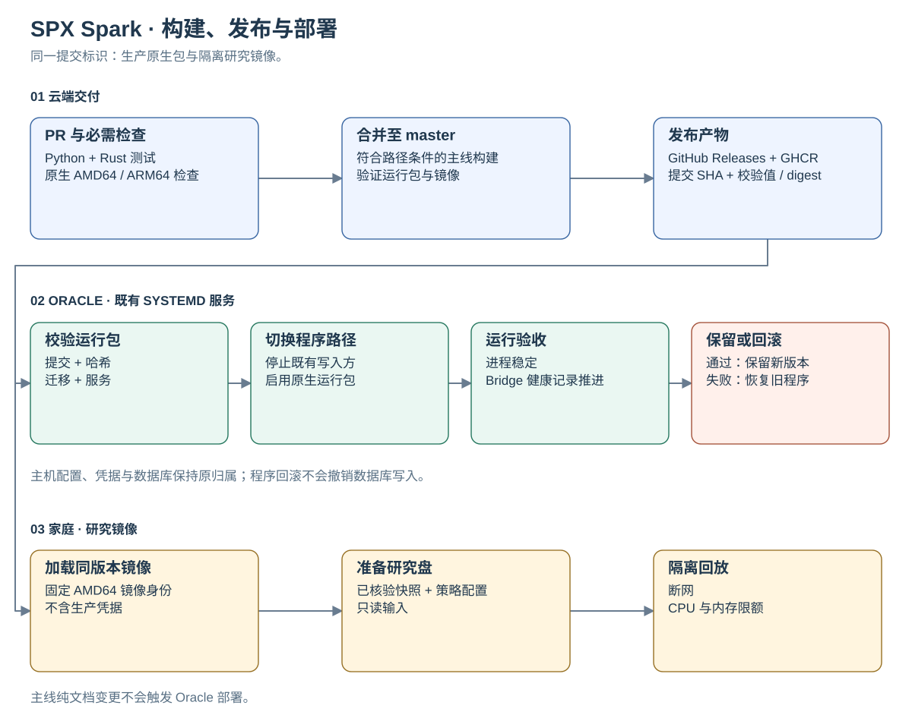
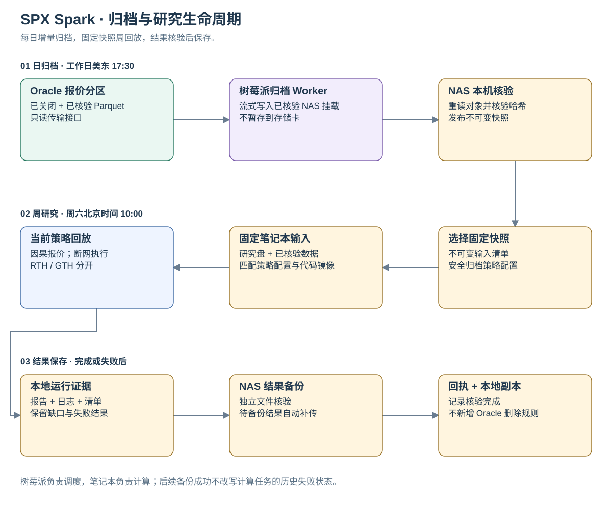

# 架构说明

[English](README.md) · [简体中文](README.zh-CN.md) · [项目主页](../../README.zh-CN.md)

**云端开发与构建，Oracle 运行生产；家庭统一调度，研究笔记本计算，NAS 保存已核验数据。**

本文记录 **2026-10-17** 核对的已部署基线，分别说明应用职责、设备分工，以及已通过的接入
验证和仍未证明的研究结论。家庭基础设施由独立运维工作区管理；本仓库包含应用、交付流水线
和接入说明，不包含完整家庭节点安装器。

## 图表目录

| 视图 | 英文 | 中文 |
| --- | --- | --- |
| 系统总览 | [SVG](diagrams/system-overview.en.svg) · [Mermaid 源码](diagrams/system-overview.en.mmd) | [SVG](diagrams/system-overview.zh-CN.svg) · [源码](diagrams/system-overview.zh-CN.mmd) |
| 运行时与数据归属 | [SVG](diagrams/runtime.en.svg) · [Mermaid 源码](diagrams/runtime.en.mmd) | [SVG](diagrams/runtime.zh-CN.svg) · [源码](diagrams/runtime.zh-CN.mmd) |
| 构建、发布与部署 | [SVG](diagrams/delivery.en.svg) · [Mermaid 源码](diagrams/delivery.en.mmd) | [SVG](diagrams/delivery.zh-CN.svg) · [源码](diagrams/delivery.zh-CN.mmd) |
| 归档与研究生命周期 | [SVG](diagrams/research.en.svg) · [Mermaid 源码](diagrams/research.en.mmd) | [SVG](diagrams/research.zh-CN.svg) · [源码](diagrams/research.zh-CN.mmd) |

SVG 可直接在 GitHub 阅读，也可打开原图。实线表示数据或产物流动；虚线表示控制、调度或
健康检查。箭头概括接口关系，不表示共享数据库写入权。

<a id="system-overview"></a>
## 系统总览


| 边界 | 负责方与用途 |
| --- | --- |
| 开发 | 开发者和 Devin 等 Agent 通过 GitHub PR 修改代码。Mac 用于审阅、运维和按需研究。 |
| 交付 | GitHub Actions 是唯一 CI 入口；同一提交标识 Python 和 Rust，GHCR 与 GitHub Releases 分发产物。 |
| 生产 | Oracle 运行既有 5 个 Python、4 个 Rust 应用服务，券商 Gateway 单独管理；负责线上写入和运行数据库。 |
| 家庭调度 | 树莓派运行 Prefect 与 PostgreSQL 元数据库；轻量归档 Worker 在笔记本关机时仍可工作，既有网络服务保持原职责。 |
| 研究计算 | Linux 笔记本在专用 `/srv/research` 研究盘上使用固定 AMD64 镜像；定时 SPX 回放限制为 4 CPU / 8 GiB。 |
| 长期保存 | NAS 保存已核验报价对象、不可变快照清单、结果和回执；实际计算读取研究盘上的本地数据集。 |

树莓派通过已有 Tailscale 连接访问 Oracle；树莓派、笔记本、NAS 同处家庭局域网。
该拓扑不要求所有设备接入 Tailscale，也不要求 Oracle 将数据库暴露给家庭网络。

OCI 保留基础设施监控职责，Prefect 跟踪任务执行和归档/研究结果；源数据新鲜度、通知回执仍由
应用分别核查。调度或虚拟机指标正常不能替代这些证据。

<a id="runtime-and-data-ownership"></a>
## 运行时与数据归属


| 职责 | 负责方 | 合同边界 |
| --- | --- | --- |
| 券商采集与标准化最新状态 | Python | 保留 provider 身份和 BBO/Greeks/OI 独立时钟，原始数据保留可用时间。 |
| 分析、候选构造和最终决策 | Python | `build_strategy_decision` 是唯一人工候选授权出口；可选研究背景不能授权交易。 |
| 人工候选通知 | 既有 Python/Huey 路径 | 使用 Python 运行状态和通知记录。 |
| Desk Map 投影 | Python | 复用已提交决策、重验当前时间，导出 `desk_map_projection.v1`；完整 `strategy_decision` 不进入 Rust wire。 |
| typed readiness、追加帧、定时报告和回执 | 既有 Rust 路径 | 拥有独立 ledger 与定时报告 outbox；不连接券商、不为 Python 策略选腿。 |
| 独立故障/恢复提醒 | 既有 Worker 监测 | 检查对应健康和新鲜度证据，使用既有直接告警路径。 |
| 真实或 Paper 下单 | 无 | 候选与报告保持人工决策辅助定位。 |

数据恢复可以在半小时定时报告之间触发更新，但不授予策略权限。进程健康、源时钟、exact-leg
完整性、决策状态、报告生成和各目标投递回执，是彼此独立的验收条件。

权威入口：[模块架构](../../module-architecture.md)、[Python/Rust 分工](../monorepo-layout.md)、
[wire 合同](../../contracts/README.md)、[通知路径](../notification-architecture.md)、
[策略合同](../README.md#strategy-contracts)。

### 存储边界

| 存储 | 位置 | 数据与生命周期 |
| --- | --- | --- |
| Python 运行 SQLite 与 Huey 队列 | Oracle | 在线决策、任务/通知状态，维持既有写入归属。 |
| Rust SQLite/WAL ledger 与 frames | Oracle | Rust 运行证据、定时报告 outbox 和投递回执。 |
| Prefect PostgreSQL | 树莓派 | 调度计划、任务定义和运行元数据，不保存行情。 |
| 报价 Parquet 对象与清单 | NAS | 已核验的标准化券商观测和压缩来源；修订内容形成新对象。 |
| 数据集缓存、DuckDB 查询和隔离回放状态 | 笔记本研究盘 | 每次任务的本地输入和计算，不写生产数据库。 |
| 研究结果与备份回执 | 笔记本 + NAS | 报告、日志、版本、配置身份、输入及校验清单。 |

当前没有新增共享应用数据库服务。分离依据是职责和数据生命周期，不将对延迟敏感的生产状态
移到家庭网络另一端。运行中的 SQLite 不能直接按普通文件复制后视为完整备份；后续数据库
归档需要一致性快照和经过验证的恢复流程。

<a id="build-release-and-deployment"></a>
## 构建、发布与部署



1. **PR 检查。** GitHub Actions 执行 Python 测试/lint、原生 AMD64/ARM64 Rust 检查与审计、容器构建和可迁移运行包验证。
2. **主线发布。** 符合条件的 `master` 构建发布 `runtime-<完整提交 SHA>` Release、SHA-256 校验值、GHCR 镜像 digest，以及家庭 Worker 使用的 AMD64 镜像归档。
3. **Oracle 校验。** 专用受限 SSH 接收器检查请求提交、归档哈希、当前分支资格、数据库迁移未变更、基线服务和部署并发。
4. **服务切换。** 准备不可变 ARM64 原生包，停止既有写入方，切换程序路径并重新启动既有服务。凭据、配置、数据路径和 Gateway 维持原归属。
5. **验收或回滚。** 检查进程稳定和运行健康/bridge 记录推进；失败恢复先前程序路径。休市报价可保持过期，部署成功不代表交易条件就绪。
6. **研究交付。** 按记录的身份加载同版本 AMD64 镜像；研究节点不编译代码，也不接收生产凭据。

**Docker 用于可复现构建和隔离研究；Oracle 生产使用 systemd 管理的原生运行包。**
正常部署不在 Oracle 上执行 Git 拉取、依赖解析或编译。版本化产物连接两个环境，不要求二者
采用同一种运行方式。

数据库迁移需单独处理，程序回滚不能撤销数据库写入；旧程序版本保留用于回滚。
`oracle-production` 环境和既有部署开关控制上线；纯文档变更不匹配工作流的部署 push 路径。

实现入口：[CI 工作流](../../.github/workflows/ci.yml)、[镜像构建](../../Dockerfile)、
[部署接收器](../../scripts/deploy-release.py)、
[部署手册](../headless-deployment.md#cloud-delivery-cutover-2026-10-17)。

<a id="archive-and-research-lifecycle"></a>
## 归档与研究生命周期



| 阶段 | 计划或触发 | 验收边界 |
| --- | --- | --- |
| 行情压缩 | Oracle 既有每小时任务 | 分区结束至少 30 分钟，压缩证据已核验。 |
| 增量归档 | 周一至周五 17:30 `America/New_York` | 仅传新增/修订内容；流式写入前核验 NAS 挂载来源。 |
| 快照发布 | 传输完成后 | NAS 本机重读每个文件、核对 SHA-256/大小，之后才更新当前快照指针。 |
| 周研究 | 周六 10:00 `Asia/Shanghai` | 执行前固定数据清单、安全生产策略配置快照和同版本镜像。 |
| 结果备份 | 完成或失败后 | NAS 核验文件；保留本地副本和匹配回执。 |
| 备份补传 | 每 15 分钟处理待备份结果 | 后续备份成功不改写计算任务已经失败的历史状态。 |

日归档对应北京时间次日美国夏令时 05:30、冬令时 06:30。传输限制在配置的美东
17:30–19:15 安静窗口内，传输预算 70 分钟；周末允许补历史数据。无新增内容是合法结果，
不表示当天发生过交易。这些是部署计划，不能替代交易所节假日日历。

树莓派直接流式写入 NAS 挂载，不将行情历史暂存到存储卡。归档包含标准化券商报价 Parquet
和压缩来源，不包含原始 JSONL、运行中的 SQLite 或凭据。安全字段白名单捕获有效生产策略
配置，回放校验对应身份；首轮回填从 **2026-10-12 UTC** 开始，并非覆盖所有历史采集时期。

周研究按任务**计划时间**确定交易周，笔记本晚开机不会悄悄换周。输入窗口为美东周日 20:15
至周五 16:15，每 5 秒推进一次，预热 20 分钟，按有界分块读取输入；仅使用模拟周期前已经
可用的观测（`received_at <= cycle`）。输入只读，回放容器断网，RTH 与 GTH 分开输出。

研究使用固定当前策略重建候选，对新选出的独立机会应用对应管理/费用规则；不使用历史策略卡
或 `NO_TRADE` 日志筛选样本，不下单、不自动把参数变更推入生产。缺报价、无候选、不完整退出
均明确保留为结果。

### 已验证接入与后续工作

截至基准日期，已执行 Oracle 云端程序交付、回滚、增量/无变化归档、当前策略短窗口回放和
NAS 结果核验，两个家庭定时计划已启用。这些接入验证不代表完整周回放已经完成、与历史线上
决策完全等价或已经证明盈利。

- **研究有效性：** 初始特征和历史宏观/模型/provider 控制状态仍不完整。报价模拟成交包含既有费用规则，但不包含真实成交、市场冲击或组合资金约束。
- **留存：** 归档成功不触发新的 Oracle 删除规则；空间回收和数据库留存需要独立制定并验证恢复。
- **恢复：** Prefect 元数据卷尚需异机备份和恢复演练；NAS 历史数据也需要独立的额外副本。
- **主机验收：** 研究盘和服务恢复已检查，笔记本整机重启验收仍待完成；树莓派当前内核不执行整容器内存 cgroup 上限，其他限制不能视为同等保证。

## 图表维护

成对修改 `.en.mmd` 与 `.zh-CN.mmd`，再重新生成 SVG。两种语言的标签、连线含义、范围和
限制须一致。SVG 随仓库提交，阅读不依赖渲染器或外部服务。

当前导出使用 Mermaid CLI **12.0.0**。在已安装 Node.js/npm 和可用 Chromium 的文档设备上，
从仓库根目录执行：

```bash
# 中文导出需要支持中文字符的 UTF-8 字体。
for source in docs/architecture/diagrams/*.mmd; do
  npx --yes --package @mermaid-js/mermaid-cli@12.0.0 mmdc \
    -i "$source" -o "${source%.mmd}.svg" -b white --no-font-embed
done
git diff --check
```

Mermaid CLI/Chromium 是文档工具，不是应用依赖。逐图检查裁切和文字重叠，核对相对链接；
公开图表不包含私有主机地址、凭据或运维原始记录。仅在重新核对实现后更新基准日期，
保留历史验收限制，不把历史结果改写成实时状态。
