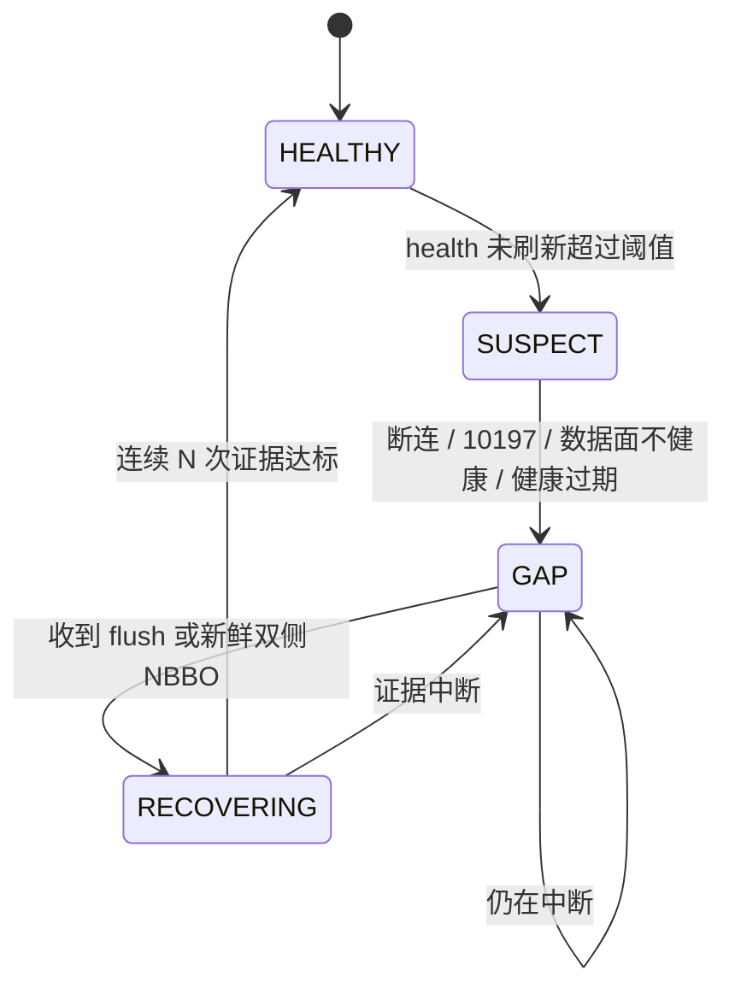

# GTH IBKR 数据中断的连续性与恢复

<!-- documentation-status: 2026-10-19 -->
> **文档定位：现行设计合同（缺口部分待实施）。** 描述 GTH 期间 IBKR SPXW 数据中断
> 时，系统如何 fail-closed、如何证明恢复，以及还缺什么。
> [全仓文档目录](README.md) · [数据能力矩阵](market-data-capability-matrix.md) ·
> [通知架构](notification-architecture.md)

以下“本变更”指包含本文修订的修复分支，不代表已合并/部署；本轮仅离线回归，未核验生产。

## 1. 已经做对的部分

GTH 的可执行建议依赖 IBKR SPXW；Schwab 的 frozen 行不能替代。当前实现：

| 机制 | 位置 | 行为 |
| --- | --- | --- |
| 健康投影 | `latest/ibkr_stream_health.json` | 区分 `process_active` 与 `data_plane_healthy`，带 `observed_at` / `expires_at` / `circuit_state` / `conflict_count` / `connection_generation` / `retry_at` |
| GTH 准入 | `gth_ibkr_entry_control` | 缺失、过期、`policy_blocked`、`circuit_state != closed`、冲突计数非 0、`10197` / competing、未连接、数据面不健康 → 全部阻断 |
| 双控制 | `market_features/service.py` → `strategy_facts.py` | 本变更将 action-time 专项控制接入统一 global gate，覆盖铁鹰等全部正式候选；缺少专项 allowed 拒绝；RTH 不套用 GTH 专项门 |
| 连续性 | `latest/ibkr_continuity.json` + `audit/ibkr_continuity.jsonl` | 状态投影及追加转移记录已存在；本变更修复静默恢复首帧绕过 rearm，健康观察时钟持续落盘 |
| 执行报价 | `gth_iron_condor.py` | 四腿报价 ≤30s、BBO skew ≤10s；不满足不给候选 |
| 状态机 | `gth_dip` / level decision | warmup、confirm samples、cooldown，避免断点后立刻发信号 |
| 文档边界 | AGENTS.md | 进程存活 ≠ 行情可用；GTH 必须等 IBKR fresh flush |

## 2. 缺口

1. **partial：健康观察连续性不等于源报价连续性**：已有 gap 转移记录；生产者静默时
   不会凭空推进状态，入口靠旧 health 过期阻断。恢复时才补记观察中断，不能证明精确断线起点。
2. **partial：默认 3 个不同 observed_at 的健康观测**：本变更修复首帧绕过、重复时间戳
   计数和 last_good_at 不更新；仍没有独立验证 N 次 flush / M 个新鲜双侧 NBBO 的证据。
3. **gap 后没有显式状态失效**：level decision、path rank、virtual episode、session
   episode 可能跨越 gap 继续使用。
4. **outage 期间的 missed opportunity 没有归因**；虽有追加的 continuity JSONL，
   尚未完成原始机会母集、incident 关联和捕获率分母。
5. 恢复后的第一条策略消息没有 `degraded_continuity` 标记，事后无法区分。

## 3. LaneContinuity 状态机

实现（含本变更）：`ibkr_stream_health.json` 每次写入都会推进
`latest/ibkr_continuity.json`，状态转移追加 `audit/ibkr_continuity.jsonl`；
`gth_ibkr_entry_control` 在 health 通过后仍会因 `GAP` / `RECOVERING` 阻断
（reason `ibkr_continuity_gap` / `ibkr_continuity_recovering`）。

本变更按相邻有效健康观测的 observed_at 间隔识别静默断档；超过 health 的
max_age_seconds（默认 90s）后，恢复首个健康观测只能成为 recovering 的第 1 个样本，
不能直接 healthy。gap_start 取最后确认的健康观测（若已有 gap 则保留原起点），
是观察中断区间的保守锚点，不声称实际断线时刻。重复/倒退的健康时间戳不推进恢复，
恢复中再次超过 health TTL 会重新从第 1 个样本计数。

下图为目标状态合同；静默中断当前在恢复时直接记录 gap_start 并进入 RECOVERING，
没有额外 watchdog/timer；无新回调期间以过期 health 阻断准入。



状态定义：

| 状态 | 条件 | 策略影响 |
| --- | --- | --- |
| `HEALTHY` | health 新鲜且 `data_plane_healthy` | 正常 |
| `SUSPECT` | 超过 suspect_after_seconds（默认 20s），但尚未超过 health TTL | 当前不是独立 veto；“降级观察”仍是目标，不能当作已接线 |
| `GAP` | 断连、10197、数据面不健康、health 过期 | 禁止新 GTH 候选；已有仓位仍按管理合同 |
| `RECOVERING` | 有 flush/新鲜报价，但未达证据门槛 | 只观察，不授权 |

## 4. Gap ledger

当前固定写 `audit/ibkr_continuity.jsonl`，不新增数据库/表。健康观测前进会刷新
latest 状态，但不会为每个 heartbeat 追加审计行；仅状态转移追加。
静默恢复首帧写 event=gap_start / reason=health_observation_gap，后续写 recovering / gap_end。
gap_seconds 是观察中断窗口，不是推算出的丢失 tick 数。

下列完整账本字段是目标合同，missed_intervals、逐腿 recovery_evidence 等仍待实施：

```
lane_continuity(
  lane, provider, state,
  gap_start, gap_end,
  missed_intervals,          # 按 lane 的采样周期估算，不伪造 tick
  last_good_source_at,
  recovery_evidence,         # flush_count / fresh_nbbo_count / both_sides
  observed_at, reason
)
```

原则：**只记录可观测事实**；没有 tick 就不补 tick，missed 用“区间数”表示，不声称具体报价。

## 5. 恢复策略

以下是**目标参数与行为**，不是已全部启用的配置项。当前只实现健康观测驱动的
suspect/rearm；`ContinuityPolicy.invalidate_after_gap_seconds` 虽已定义但尚无生命周期
失效消费者。post_gap_rearm、degraded_continuity、ops 恢复消息与 outage 归因仍待实施。

| 参数 | 建议值 | 说明 |
| --- | --- | --- |
| `suspect_after_seconds` | 15–30 | 与 health max age 对齐 |
| `gap_confirm_seconds` | 30 | 超过即判 GAP |
| `invalidate_state_after_gap_seconds` | 60 | 失效 level/path/virtual 等连续性状态 |
| `rearm_evidence` | 连续 3 次 flush + 双侧 NBBO | 才允许回到 HEALTHY |
| `rearm_observe_seconds` | 30–60 | 只观察窗口 |
| `degraded_mark_seconds` | gap 结束后 300 | 该窗口内 decision 打 `degraded_continuity` |

规则：

1. GAP 期间不产生新的 GTH 可执行候选；已有仓位按 management policy 继续。
2. gap > 60s：清空依赖连续性的状态（level decision、path rank、virtual episode），
   下一个决策带 `post_gap_rearm=true`。
3. 恢复后先发一条 **ops 消息**（gap facts + 恢复证据），与策略消息分开；
   策略消息带 `degraded_continuity` 标记，进入 outcome 归因。
4. 不用“重启进程”或“定时器跑过”当作恢复证据；只认 source timestamp 前进。

## 6. 与机会捕捉的关系

outage 窗口要能被归因：当天的大 move 如果落在 GAP 内，capture report 应显示
`unavailable_outage`，而不是“策略没识别”。见 [机会捕捉台账](opportunity-capture.md)。

## 7. 验收

本变更离线回归覆盖：正式铁鹰 GTH gap/recovering/10197 阻断与 RTH 隔离、
静默 5 分钟后默认 3 个不同健康观测恢复、重复观测不增加样本、恢复期间再中断重计、
健康时钟落盘。没有连接 broker、发送通知或做生产断网实验。

下面仍是**待实施能力的集成/生产验收目标**，不能据单元回归宣称通过：

- 人为断开 IBKR 60s：GTH 候选在 30s 内停止；恢复后 30–60s 内只观察；
- gap ledger 有 start/end、missed 区间、恢复证据；
- 同一 session 的 decision 能按时间轴回放，标出 GAP 与 RECOVERING；
- 不新增 provider、不改变 Schwab 的 RTH owner、不补造 tick。

## 8. 非目标

- 不做跨 provider 的自动回填（没有数据就是没有数据）；
- 不把 Schwab frozen 行当 GTH 行情；
- 不因为恢复而放宽 30s/10s 执行报价门槛。
