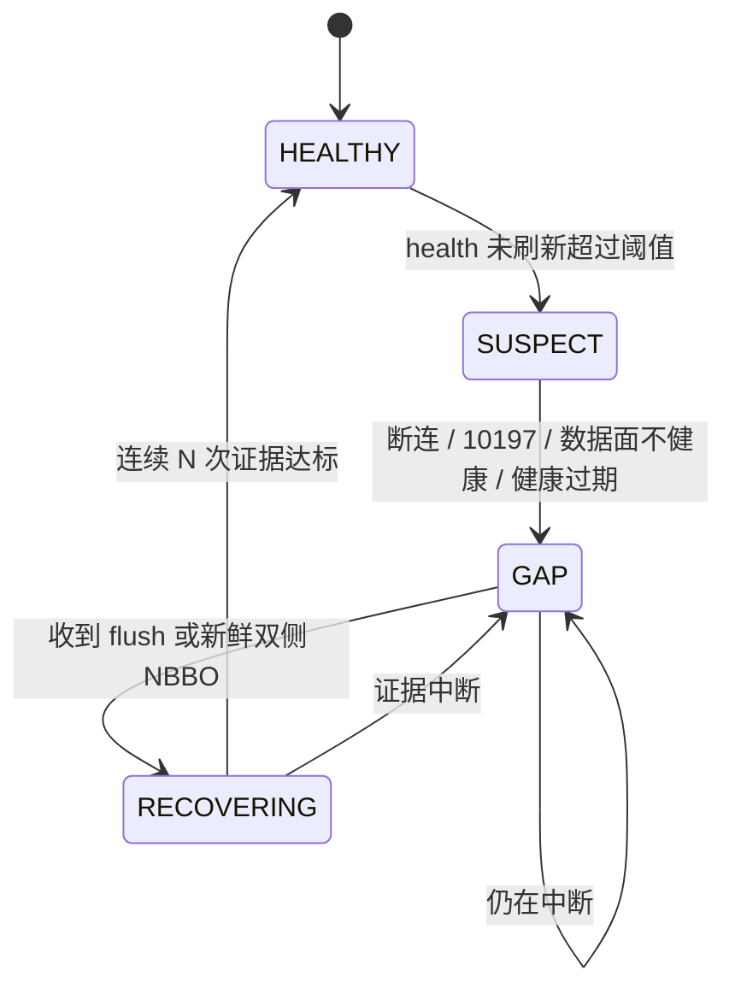

# GTH IBKR 数据中断的连续性与恢复

<!-- documentation-status: 2026-10-18 -->
> **文档定位：现行设计合同（缺口部分待实施）。** 描述 GTH 期间 IBKR SPXW 数据中断
> 时，系统如何 fail-closed、如何证明恢复，以及还缺什么。
> [全仓文档目录](README.md) · [数据能力矩阵](market-data-capability-matrix.md) ·
> [通知架构](notification-architecture.md)

## 1. 已经做对的部分

GTH 的可执行建议依赖 IBKR SPXW；Schwab 的 frozen 行不能替代。当前实现：

| 机制 | 位置 | 行为 |
| --- | --- | --- |
| 健康投影 | `latest/ibkr_stream_health.json` | 区分 `process_active` 与 `data_plane_healthy`，带 `observed_at` / `expires_at` / `circuit_state` / `conflict_count` / `connection_generation` / `retry_at` |
| GTH 准入 | `gth_ibkr_entry_control` | 缺失、过期、`policy_blocked`、`circuit_state != closed`、冲突计数非 0、`10197` / competing、未连接、数据面不健康 → 全部阻断 |
| 双控制 | `market_features/service.py` | GTH 需要通用 provider control 与 IBKR 专项 control **同时** allowed |
| 执行报价 | `gth_iron_condor.py` | 四腿报价 ≤30s、BBO skew ≤10s；不满足不给候选 |
| 状态机 | `gth_dip` / level decision | warmup、confirm samples、cooldown，避免断点后立刻发信号 |
| 文档边界 | AGENTS.md | 进程存活 ≠ 行情可用；GTH 必须等 IBKR fresh flush |

## 2. 缺口

1. **健康是当前状态，不是连续性证据**：没有“14:00–14:07 断了、错过哪些区间”的记录。
2. **恢复门槛只有“当下 healthy”**：没有 N 次连续 flush / M 个新鲜双侧 NBBO 的证据。
3. **gap 后没有显式状态失效**：level decision、path rank、virtual episode、session
   episode 可能跨越 gap 继续使用。
4. **outage 期间的 missed opportunity 没有归因**，也没有 append-only 的 incident 表。
5. 恢复后的第一条策略消息没有 `degraded_continuity` 标记，事后无法区分。

## 3. LaneContinuity 状态机



状态定义：

| 状态 | 条件 | 策略影响 |
| --- | --- | --- |
| `HEALTHY` | health 新鲜且 `data_plane_healthy` | 正常 |
| `SUSPECT` | 超过 `max_age` 未刷新，但未确认断连 | 新候选降级为观察 |
| `GAP` | 断连、10197、数据面不健康、health 过期 | 禁止新 GTH 候选；已有仓位仍按管理合同 |
| `RECOVERING` | 有 flush/新鲜报价，但未达证据门槛 | 只观察，不授权 |

## 4. Gap ledger

每次状态转移写一行（append-only，落 `spx.sqlite` 或 JSONL，二者择一但要固定）：

```
lane_continuity(
  lane, provider, state,
  gap_start, gap_end,
  missed_intervals,          # 按 lane 的采样周期估算，不伪造 tick
  last_good_source_at,
  recovery_evidence,         # flush_count / fresh_nbbo_count / both_sides
  observed_at, reason
)
```

原则：**只记录可观测事实**；没有 tick 就不补 tick，missed 用“区间数”表示，不声称具体报价。

## 5. 恢复策略

| 参数 | 建议值 | 说明 |
| --- | --- | --- |
| `suspect_after_seconds` | 15–30 | 与 health max age 对齐 |
| `gap_confirm_seconds` | 30 | 超过即判 GAP |
| `invalidate_state_after_gap_seconds` | 60 | 失效 level/path/virtual 等连续性状态 |
| `rearm_evidence` | 连续 3 次 flush + 双侧 NBBO | 才允许回到 HEALTHY |
| `rearm_observe_seconds` | 30–60 | 只观察窗口 |
| `degraded_mark_seconds` | gap 结束后 300 | 该窗口内 decision 打 `degraded_continuity` |

规则：

1. GAP 期间不产生新的 GTH 可执行候选；已有仓位按 management policy 继续。
2. gap > 60s：清空依赖连续性的状态（level decision、path rank、virtual episode），
   下一个决策带 `post_gap_rearm=true`。
3. 恢复后先发一条 **ops 消息**（gap facts + 恢复证据），与策略消息分开；
   策略消息带 `degraded_continuity` 标记，进入 outcome 归因。
4. 不用“重启进程”或“定时器跑过”当作恢复证据；只认 source timestamp 前进。

## 6. 与机会捕捉的关系

outage 窗口要能被归因：当天的大 move 如果落在 GAP 内，capture report 应显示
`unavailable_outage`，而不是“策略没识别”。见 [机会捕捉台账](opportunity-capture.md)。

## 7. 验收

- 人为断开 IBKR 60s：GTH 候选在 30s 内停止；恢复后 30–60s 内只观察；
- gap ledger 有 start/end、missed 区间、恢复证据；
- 同一 session 的 decision 能按时间轴回放，标出 GAP 与 RECOVERING；
- 不新增 provider、不改变 Schwab 的 RTH owner、不补造 tick。

## 8. 非目标

- 不做跨 provider 的自动回填（没有数据就是没有数据）；
- 不把 Schwab frozen 行当 GTH 行情；
- 不因为恢复而放宽 30s/10s 执行报价门槛。
