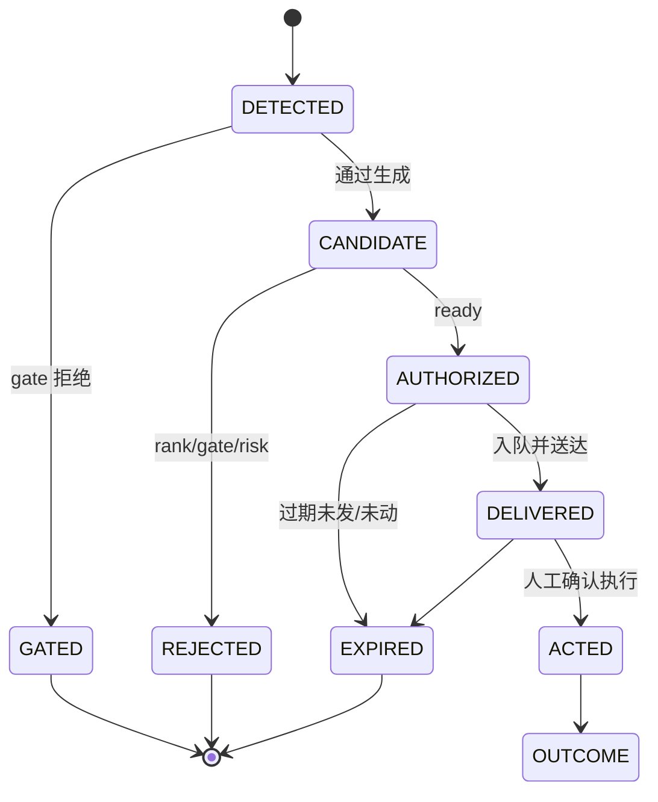

# 机会捕捉台账与归因

<!-- documentation-status: 2026-10-18 -->
> **文档定位：现行设计合同（第一阶段已实施）。** 把“为什么没发”与“有没有抓到”分开度量。
> [全仓文档目录](README.md) · [决策协议](architecture/decision-protocol.md) ·
> [GTH 连续性](gth-continuity-recovery.md)

## 1. 现状

现状（2026-10-18）：Worker 每分钟读取 `latest/strategy_decision.json`，按
`decision_id + state` 去重，把最终决策写入
`opportunities/date=YYYY-MM-DD.jsonl`（state = authorized / detected / rejected，
带 stage、reason codes、correlation_id）。报告用 `notification_events.correlation_id`
与 `status='delivered'` 计算 authorized_delivered / authorized_not_delivered。
这些计数仅表示 Python 记录中的投递／交接证据；`rust_ingress` 成功代表 Rust 接收，
不代表终端已送达，缺少证据也不等于确认投递失败。DB 不可读或缺字段时计数为 null。
行情目录取 `StorageSettings.data_root`，运营数据库取独立的 `SPX_DATA_ROOT/spx.sqlite`；
研究机报告可用 `--data-root` 和 `--database` 分别指定两处路径。
acted 没有执行回执，返回 null（未知），绝不推断为零成交。
当前是每分钟采样 latest decision，不是完整机会台账，不能据此计算机会捕获率或漏报率。`scripts/opportunity-capture-report.py`
输出当日或 `--week-ending` 的周报（`capture_week_summary`）。

系统已经有足够的**原料**，但没有一个统一的机会台账：

| 原料 | 位置 | 已能回答 |
| --- | --- | --- |
| `rejection_funnel` | `strategy_select` | 为什么没授权（几十个 reason code） |
| `gate_audit` | `rank_candidates` | 哪个 gate 拒了哪个候选 |
| `strategy_outcomes` | 多 horizon marks | 候选之后的保守估值 |
| `virtual_strategy` | `process_virtual_strategy` | 观察/虚拟账本的入场与退出 |
| `play_stats` | `PlayOutcomeStatsProvider` | 历史 play 的统计 |
| 通知记录 | `notification_events` / receipts | 有没有发、有没有送达 |

缺口：无法回答“今天 3 次 >0.5 EM 的移动，我们抓到几次、卡在哪一步、延迟多少”。

## 2. Opportunity Ledger

每个机会一行，状态只前进：



字段：

```
opportunity_id, session_date, lane, strategy_id, structure,
detected_at, decision_at, delivered_at, acted_at,
state, reason_codes[],
quote_age_ms, evidence_age_ms,
policy_version, model_version, correlation_id,
outcome_marks[]
```

`reason_codes` 直接复用现有 funnel/gate 的 code，不新造一套命名。

## 3. 度量

按交易日和按周输出：

| 指标 | 定义 |
| --- | --- |
| Detection rate | 大 move（>0.5 / 1.0 EM）中，至少被 DETECTED 的比例 |
| Authorization rate | DETECTED 中进入 AUTHORIZED 的比例 |
| Delivery rate | AUTHORIZED 中收到成功回执的比例 |
| Action rate | DELIVERED 中人工 ACTED 的比例（仅由明确人工确认记录，缺失为未知） |
| Time-to-ready | detected → authorized 的 P50/P95 |
| Time-to-deliver | authorized → receipt 的 P50/P95 |
| Top miss reasons | 每个 reason code 在未授权中的占比 |
| Outage miss | 落在 GTH GAP 内的大 move 数（归因 `unavailable_outage`） |

大 move 的定义必须来自原始报价（按当时可用时间），不能用策略卡或推送记录筛样本。

## 4. 反事实（只研究）

对未授权机会，用 shadow management policy 在原始报价上计算 mark：

- 只用于回答“如果授权会怎样”，不进入授权、不改阈值；
- 必须标明 `research_unvalidated`、样本 n、是否校准；
- 不能因为某次反事实盈利就放宽 gate。

## 5. 实施顺序

1. 在现有 `strategy_decision` 出口写 `opportunity_id` 与状态（不新建表也可先写 JSONL）；
2. 把 `rejection_funnel` 的 reason code 映射到台账；
3. 通知回执按 `opportunity_id` 关联；
4. 每日生成 capture report（可以先用脚本，不新增常驻服务）；
5. 稳定后再考虑落 `spx.sqlite` 表与索引。

## 6. 验收

- 任取一个大 move，能沿台账回答 detected / gated / authorized / delivered / acted；
- 同一机会在重启后不重复计数（幂等键 = session + structure + detection window）；
- outage 窗口的 move 不会被误归因为“策略没识别”；
- 报告中的数字与原始报价回放一致，且标注未校准。

## 7. 非目标

- 不做自动交易、不把 action rate 当收益；
- 不用通知记录筛选研究样本；
- 不新增常驻服务或数据库。
